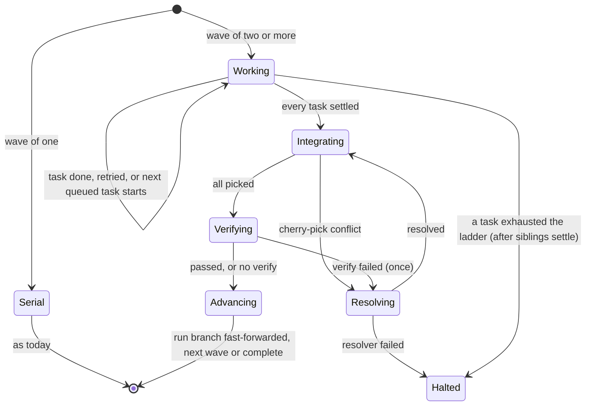

# Parallel Task Execution — Specification

Oct 19, 2026 · @Tim · Branch `parallelism` · Status: draft for review, nothing built

Today a tierminator run is serial: one worker at a time, in one working tree, with a failed attempt undone
by `git reset --hard`. This spec adds parallel execution of independent tasks. The planner declares which
tasks depend on which; tierminator groups them into waves; the tasks of a wave run at the same time, each
in its own Git worktree; their commits are brought back onto the run branch in plan order; and a new
conflict-resolver agent repairs what does not apply cleanly.

Everything here is a decision made with the user on 2026-10-19 unless it is listed under
[Open decisions](#open-decisions). Claims about how Claude Code behaves are assumptions until a probe in
[Probes](#probes) backs them with an evidence file; the design says where it depends on one.

## Goals and non-goals

**Goals**

- **Wall-clock time and use of the usage limit.** Independent tasks finish in roughly the time of the slowest,
  and a run draws on the usage limit while the user waits.
- **Serial plans do not change.** A plan with no `after` field runs exactly as it does today, on the same
  code path, with the same tests passing unmodified.
- **Deterministic.** Waves, dispatch, integration order and halting come from hook code, never from a model
  recalling them. Only conflict resolution is a model's judgment.
- **Same safety rules.** One commit per task, no pushing, no pause between tasks, a failed attempt is rolled
  back, and a halt leaves the evidence in place.

**Non-goals**

- Starting a task as soon as its own dependencies finish. Tasks start by wave: a task waits for the whole
  previous wave. (A ready-set scheduler would be faster; waves were chosen for being simpler to reason about
  and to resume.)
- Enforcing independence. There is no `files` field and H2 does not reject overlapping tasks; the planner's
  judgment and the resolver cover it. The one check is a review flag that asks the planner to confirm two
  parallel tasks naming the same file (O6); it rejects nothing outright.
- Nested subagents, per-task approval gates and pushing, as before.
- Grindinator changes. It drives tierminator headless and gets parallelism for free if headless works
  (decision: headless is in scope, see [Headless](#headless)).

## Decisions already made

| # | Decision |
|---|---|
| D1 | The plan declares dependencies with `after`. Waves are derived from the graph. |
| D2 | A task with no `after` depends on the task before it (today's behavior). Parallelism needs `after: []` or an explicit list. |
| D3 | A failed task retries up the tier ladder in place, in a fresh worktree, while its siblings keep running. The wave closes when every task has settled. If a task exhausts the ladder, its siblings finish, the tasks that passed are integrated, and the run halts. |
| D4 | Each task runs in its own Git worktree. Finished tasks are brought back by cherry-pick in plan order, one commit per task. |
| D5 | A merge-conflict resolver agent, `opus` at `high`, repairs conflicts. If it fails, the run halts. |
| D6 | The cap on tasks running at once is `TIERMINATOR_MAX_PARALLEL`, default 5. |
| D7 | The plan has an optional plan-level `setup` (run in each new worktree) and `verify` (run after a wave is integrated). |
| D8 | `/tierminator:execute --from` is refused for graph plans; they resume from what is committed. Plans without `after` keep `--from`. |
| D9 | Plans and the run summary show waves and the parallel speed-up. |
| D10 | Headless runs (`claude -p`) run waves in parallel too, with the same result file and telemetry. |
| D11 | There is no `files` field (the user chose to skip it). |

## Concepts

- **Graph plan.** A plan in which at least one task has an explicit `after`. Any other plan is a *serial
  plan*, and runs the serial way.
- **Wave.** `wave(T) = 1` when `T` has no dependencies, else `1 + max(wave(d))` over its dependencies `d`.
  All tasks in a wave are independent of each other, since a dependency always lands in an earlier wave.
- **Serial wave.** A wave of one task. It runs in the main working tree through today's code, unchanged:
  `current`, the clean-tree check, `reset --hard` on failure. A serial plan is nothing but serial waves.
- **Parallel wave.** A wave of two or more tasks. It runs through the wave machinery below.
- **Run branch.** The branch the run started on (`state.branch`). The main working tree stays on it and stays
  clean for the whole run.
- **Wave base.** The run branch's HEAD when a wave starts.
- **Slot.** The state of one task in a parallel wave (its attempt, tier, worktree, branch and so on). It is
  what `current` is for a serial wave.
- **Integration worktree.** A throwaway worktree, on a branch started at the wave base, where a wave's
  commits are cherry-picked, repaired and verified before the run branch moves.

## The plan

### Task block

```json
{
  "setup": ["npm ci"],
  "verify": "npm test",
  "tasks": [
    { "id": "T01", "title": "…", "model": "sonnet", "effort": "medium", "prompt": "… Verify: …" },
    { "id": "T02", "title": "…", "model": "sonnet", "effort": "medium", "after": [],            "prompt": "…" },
    { "id": "T03", "title": "…", "model": "haiku",  "effort": "high",   "after": [],            "prompt": "…" },
    { "id": "T04", "title": "…", "model": "opus",   "effort": "medium", "after": ["T02","T03"], "prompt": "…" }
  ]
}
```

| Field | Rule |
|---|---|
| `tasks[].after` | Optional array of task ids. Absent: `[previous task's id]`, or `[]` for `T01`. Each id must name an earlier task (so a cycle cannot be written). No duplicates, no self reference. Redundant edges (a dependency already implied by another) are allowed. |
| `setup` | Optional array of command strings, run in order in each new worktree. See [Setup](#setup). |
| `verify` | Optional string, one command, run after a parallel wave is integrated. See [Plan-level verify](#plan-level-verify). |

The top-level object may hold only `tasks`, `setup` and `verify`. Ids still run `T01`, `T02`, … in order with
no gaps, which is now a topological order; execution order within a wave, and integration order, is id order.

`parseBlock` normalizes every task to carry an explicit `after`, and records `graph: true` when the planner
wrote any `after`. Everything downstream reads the normalized array.

### Validation (H2)

Adds to today's checks: `after` is an array of strings naming earlier tasks; no duplicates; `setup` is an
array of non-empty single-line strings (at most 10); `verify` is a non-empty single-line string; no unknown
top-level keys. Errors are collected, as now.

### The approval table

The generated section gains a `Wave` and an `After` column, and lists `setup` and `verify` verbatim, because
the approved plan makes tierminator run those commands:

```
| ID  | Wave | After    | Title … | Model | Effort | Prompt |
Setup: npm ci
Verify (after each parallel wave): npm test
Waves: 1: T01, T02, T03 · 2: T04
```

The tasks file and its hash cover the whole block, so `setup` and `verify` cannot change after approval.

### Planner rules (`rules/tiering.md`)

New section "Dependencies and parallel tasks". The rules tell the planner to:

- leave `after` off when each task needs the one before it (the common case);
- write `after: []` or a list only when tasks truly can run at once: they read and change different files,
  need none of each other's output and share no build output;
- give each parallel task its own `Files to change:` line and keep those lines disjoint (guidance only);
- remember that a task also waits for every other task in its dependencies' wave, so splitting a chain into
  a wide graph helps only if the waves are wide;
- put work every task needs (a shared interface, a rename) in an earlier wave.

The existing line "A task can depend only on earlier tasks" is replaced.

## Execution

### Lifecycle



### Starting a wave

1. The hook that settles the previous wave (or approval, for wave 1) computes the next wave from the tasks
   not yet done, treating done tasks as satisfied.
2. A wave of one is a serial wave. Otherwise the wave base is recorded, the slots are created, and the first
   `min(size, cap)` tasks are marked startable. The cap is `TIERMINATOR_MAX_PARALLEL` (a positive integer; an
   unset or invalid value means 5). Tasks beyond the cap are queued and start, in id order, as slots free.
3. Claude is told to make all the startable Agent calls **in one message**, each with its exact dispatch
   text. Each call is checked by H4 (`pre`) against the slot it names.

### The dispatch of one task

The prompt is today's (`Tasks file:`, `Plan:`, `Task:`, and for a retry `Retry:` and `Reason:`) plus, in a
parallel wave, a `Parallel: yes` line so the worker knows it is in a worktree and must run `setup`. How the
worker is placed in its worktree depends on probes P1 and P2:

- **M1, the Agent tool's `isolation: "worktree"`.** The worktree and branch are made by Claude Code. H4 `pre`
  either requires the parameter on the call or adds it with `updatedInput` (never `permissionDecision`).
- **M2, hook-made worktrees.** H4 `pre` runs `git worktree add -b tierminator/<runId>/<id> <path> <waveBase>`
  and the prompt gains a `Worktree: <absolute path>` line the worker must treat as its working directory.

M1 is preferred. M2 is the fallback if probes show the subagent cannot be reliably placed. The design below
speaks of a slot's `worktree` and `branch` and does not depend on which mechanism makes them.

Worktree adds are serialized (Git locks its worktree metadata), through the state lock below.

### Judging a task

As today, in the slot's worktree: a readable report (or the Git evidence that stands in for it), exactly one
commit since the slot's recorded head carrying `Tierminator-Task: <id>` and `Tierminator-Plan: <planId>`, a
clean tree, and the worker still on its own branch. The report block, the turn-limit resume (at most twice)
and the single request for a missing report are unchanged and work per slot.

A failed attempt is rolled back by **discarding the worktree and its branch** and creating a fresh one from
the same wave base, at the next tier up (at most two retries, as now). No `reset --hard` is run in a parallel
wave. The other slots are not touched.

### Closing a wave

A wave closes when no slot is in flight and none is queued to start.

- **All tasks done.** Integrate.
- **A task exhausted the ladder or hit a fatal.** Nothing queued starts. In-flight siblings finish, and are
  judged, retried or not as usual. When the last settles, the tasks that passed are integrated (so their work
  is kept and `/tierminator:execute` later skips them), and the run halts. The halt names the failed task.

### Integration

Run by hook code (no model), in `<data dir>/…/integration`, a worktree on branch `tierminator/<runId>/wave-<n>`
started at the wave base:

1. For each done task of the wave in id order, `git cherry-pick <task commit>` (no `-x`, so the message and its
   `Tierminator-` trailers are kept as they are, which `committedTasks` reads for resuming).
2. A clean pick continues to the next.
3. A conflicting pick stops with the pick in progress and goes to the [resolver](#the-conflict-resolver).
4. When every pick is in, the plan's `verify` runs there ([Plan-level verify](#plan-level-verify)).
5. The run branch is moved with `git merge --ff-only` in the main tree, which is clean and unmoved since the
   wave base, so the fast-forward is a pure ref move. If the run branch is no longer the wave base (the user
   committed during the run), the run halts with that reason and the integration branch is kept.
6. The task worktrees, their branches and the integration worktree and branch are removed.

Integration happens once per wave, so history on the run branch is linear: the commits of wave 1 in id order,
then wave 2's, and so on, one per task.

### The conflict resolver

A new agent, `tierminator:resolver`, `model: opus`, `effort: high`, `maxTurns: 150`, `disallowedTools: Agent,
Workflow`. Not one of the six tiers: it is never chosen by a plan and never in the retry ladder.

- **Where.** In the integration worktree, with the pick in progress (conflict markers present, `CHERRY_PICK_HEAD`
  set). If probes P1 and P2 show a subagent cannot be pointed at an existing worktree, it gets its own
  worktree and the hook fast-forwards the integration branch to its result.
- **Prompt.** Written by the hook, not the planner: the conflicting task's id, title and prompt; the id, title
  and prompt of each task already picked in this wave; the conflicting files; and the instruction to keep the
  intent of both. It also names the `Verify:` lines of the tasks involved.
- **Rules.** Resolve the conflicts by editing the files with the file tools (no heredocs), never delete or
  weaken a test, run the involved tasks' `Verify:` steps, then `git add` and `git cherry-pick --continue`
  keeping the original message, and end with the same report block as a worker. It never aborts the pick, never
  resets, switches branches, rebases or pushes.
- **Judged by hook code.** The pick is no longer in progress, the tree is clean, exactly one new commit sits on
  the integration tip with the task's trailers, and the report says `VERIFY: PASS`. The turn-limit resume and
  the missing-report request apply as for workers.
- **On failure the run halts** (D5): no retry, no second resolver. The integration worktree is left in place so
  the user can look, with the pick state as the resolver left it.
- **Spend** is recorded under the tier `resolver`, priced as `opus`.

### Setup

`setup` commands run in each new worktree before the worker starts the task. The worker runs them (the prompt
says `Parallel: yes`; the worker's rules say to run the tasks file's `setup` list first, in order, with its
shell, and to stop at the first failure). A failed setup is not the worker's fault: it reports `FAILED` with a
`NOTE:` starting `SETUP FAILED:`, and the judge treats that as **fatal** (the run halts, no retry up the
ladder, since a bigger model cannot fix a missing tool). A list of strings, not one string, so no `&&`
chaining is needed and each command is the platform shell's own.

Setup is for what a fresh worktree lacks because Git does not track it: restores, `node_modules`, a copied
`.env`. It does not run in serial waves, whose tree is already set up.

### Plan-level verify

`verify` is one command, run by hook code in the integration worktree after all picks of a **parallel wave**
(never for a serial wave, which its task's own `Verify:` already covers). It guards against picks that apply
cleanly and still break together.

- Exit 0 passes. Anything else fails, with its output (tail, bounded) kept.
- A failure sends the resolver in once, with the verify command, its output and the whole wave's prompts, to
  repair the integration; its fix is one commit with the trailer `Tierminator-Task: W<n>` (which resume
  ignores). If the resolver fails or verify still fails, the run halts (O2 asks for confirmation of this).
- It runs with a timeout, `TIERMINATOR_VERIFY_TIMEOUT` seconds (default 900). Whether a hook can run that
  long is probe P5.

### State

A parallel wave replaces `current` with `wave`; a serial wave keeps `current`, so serial plans are untouched.

```
wave: {
  n, size, base,                       // wave number, task ids, wave base sha
  slots: { T02: {attempt, tier, tried[], head, worktree, branch, inFlight, report,
                  lastFailure, agentId, resumes, resumePending, turnLimited, asked, resumeFor,
                  startedAt}, … },
  queue: ['T05'],                      // not started yet
  phase: 'working' | 'integrating' | 'resolving' | 'verifying',
  halting: null | {task, reason},      // set when a task exhausted the ladder
  integration: {worktree, branch, picked[], conflict}   // while integrating
}
```

`done` is unchanged, and gains `wave`. `runId`, `planId`, `branch`, `spend` and the rest of the run state are
unchanged.

**The state lock.** Several workers can stop within milliseconds, in separate hook processes, and today's
read, change, `write` is not atomic as a whole (only the write is; `claimAttempt` guards single attempts).
Parallel waves need a transaction: `state.update(sessionId, fn)` takes an exclusive lock file beside the state
(`wx` create, short retries, and a stale-lock timeout that removes a lock whose owner died), reads, applies
`fn`, writes, and releases. Every parallel-wave mutation goes through it. Attempt keys gain the task id so
claims are per slot. The Windows rename retries in `write` stay.

### Notices

Every hand-back or finish of a task yields a notice for that task, as now. Since several can arrive
back-to-back, the notice says only what is true at that moment:

- queued tasks and free slots: dispatch the next startable one(s);
- others still running: end your turn (the next hand-back will say more);
- the last task settled: integration ran in the hook, so the notice gives the next wave's dispatch text, the
  completion text, the halt text, or the resolver's dispatch.

H5 keeps blocking main-thread edits and early stops; its wait-states understand that several workers are in
flight.

### Usage limit

A usage limit ends the run once, as today (H7 records outcome `limit` with its reset time). Attempts of other
slots that end because of the same limit are **not judged**: no reset, no retry, no ladder step. They are
discarded with their worktrees, and `/tierminator:execute` re-runs the wave afterward. Tasks already
integrated are skipped by resume.

## Resuming

`/tierminator:execute` already skips tasks whose commits are on the branch. For a graph plan:

- done tasks are those whose `Tierminator-Task:` commits are on the branch; waves are recomputed over the rest,
  with a done dependency counting as satisfied;
- `--from Txx` is refused with a message saying graph plans resume from what is committed (D8);
- before starting, it removes worktrees and branches left by an earlier halted or ended run (`git worktree
  prune`, and `tierminator/<oldRunId>/*` branches, the integration worktree included), after telling the user
  what it found.

## Headless

`claude -p` runs waves the same way, with no approval. The result file keeps its schema version and gains
optional fields (`waves`, `parallelPeak`, `wallClockSeconds`); an existing reader that ignores unknown fields
is unaffected (to be confirmed against `result.test.js`, O5).

## Telemetry and display

- **Attribution** of worker usage moves from time windows to agent ids (SubagentStop's `agent_id` and
  transcript path), since windows overlap now. Spend records gain `wave` and `parallel`. Resolver spend is its
  own tier row.
- **Run lines** (H5) show `wave 2 of 4: T03, T04, T05 running in parallel (3/5 slots)`, and the finish line of
  a task its wave.
- **End summary** gains wall-clock time, the serial estimate (sum of task durations), and the speed-up between
  them, beside the existing token and cost lines. Parallelism changes time, not cost, and the summary says so.
- **Plan table** shows waves, as above.

## Changes by file

| Area | Change |
|---|---|
| `lib/tasks.js` | `after`, `setup`, `verify`; validation; normalized output; `graph` flag. |
| `lib/waves.js` (new) | Pure: waves from the graph, recomputed over remaining tasks, startable set under the cap. |
| `lib/run.js` | Unchanged for serial waves. Slot analogues of `expectedCall`, `checkDispatch`, `judge`, `advance`, `noticeText`. Probably a sibling module, `lib/wave-run.js`, to keep `run.js` as it is. |
| `lib/state.js` | `update` with the lock; claims keyed by task. |
| `lib/git.js` | Worktree add/remove/prune, branch delete, cherry-pick (with conflict reporting), fast-forward, leftover detection. All swallow errors as the rest do. |
| `lib/integrate.js` (new) | Integration, verify and the resolver's judging. |
| `h2-gate-exit-plan.js` | Validation; table with waves. |
| `lib/sizing.js` | The overlap review flag (O6): independent tasks that name the same file. |
| `h3-post-approval.js`, `lib/execute.js` | Start the first wave; graph-plan resume; `--from` refusal; leftover cleanup. |
| `h4-dispatch.js` | Per-slot `pre`, `stop`, `post`, `failure` and resume hooks for parallel waves; serial paths untouched. |
| `h1-plan-rules.js`, `h5-guard.js`, `h7-limit.js` | Hand-back and wait-states per slot; the limit rule above. |
| `lib/spend.js`, `lib/usage.js`, `lib/telemetry.js`, `lib/result.js` | Agent-id attribution; wave fields; the summary lines. |
| `agents/resolver.md` (new), all tier agents | Resolver; a "Parallel" section in the shared worker body (run `setup`, work in the worktree, the `SETUP FAILED:` note). |
| `hooks/hooks.json` | Longer timeouts for the hooks that integrate and verify (P5). |
| `rules/tiering.md` | The dependency section. |
| Docs | `tierminator-reference.md` (replace the "Serial only" non-goal), `README.md`, `CLAUDE.md`, `docs/README.md`, the spike spec's non-goal note. |

## Probes

Each probe lives under `probes/`, writes `probes/evidence/tierminator-parallel-*`, and gets a findings
section (`tierminator-parallel-findings.md`) before the code that depends on it. They run on the Claude Code
version in use, interactive and headless where it matters.

| # | Question | Decides |
|---|---|---|
| P1 | With the Agent tool's `isolation: "worktree"`: does it apply to plugin agents (`tierminator:<tier>`)? Can H4 `pre` set it with `updatedInput`, or must the model pass it? Where do the worktree path and branch appear (SubagentStop, PostToolUse)? What commit is the worktree based on? What happens to a worktree that has a commit when the worker ends? | M1 or M2 |
| P2 | Can a subagent be told to work in an existing worktree path and hold to it (file tools, Bash cwd, CLAUDE.md lookup)? | M2, and where the resolver runs |
| P3 | Do several Agent calls in one message run concurrently? Do their `pre` hooks run as concurrent processes? Reproduce a lost update with two near-simultaneous SubagentStops against today's state file. | Concurrency, the state lock |
| P4 | When three background workers finish close together, how many prompts reach Claude, in what order, and does H5's wait-state work? | Notices |
| P5 | Can a hook run for minutes (cherry-pick plus a build) with a raised `timeout`? Does it block other hooks or Claude? Is there a maximum? | Where integration and verify run |
| P6 | Git on Windows: concurrent `git worktree add`, path length, `cherry-pick` conflict reporting, trailers surviving without `-x`, `index.lock` per worktree, removal of a worktree with a locked file. | Git helpers |
| P7 | A seeded two-task conflict resolved by `opus` at `high`: turns, cost, whether the report block and `--continue` come out right. | The resolver prompt and `maxTurns` |
| P8 | A usage limit with several workers in flight (the Grindinator mock API can fake one): which hooks fire, whether in-flight workers fail with it. | The limit rule |

If P1 or P2 fails, the feature falls back to M2, and if both fail it does not proceed.

## Rollout

Phases, each ending with its tests passing and its acceptance criteria met; no phase starts before the probes
it depends on have findings. The phases are split into paste-ready work packages in
[`parallel/`](parallel/README.md) (seventeen, WP-01 to WP-17), which map to the phases below.

1. **Probes** P1 to P8 and the findings doc.
2. **Plan format**: `tasks.js`, `waves.js`, H2 table, rules, tests. A graph plan is accepted and shown, and
   still runs serially (every wave treated as serial) until phase 4. Existing tests pass untouched.
3. **Git and state**: worktree/pick/fast-forward helpers, `state.update`, with tests including real
   concurrent writers.
4. **Parallel waves, no resolver**: slots, dispatch, judging, retries, closing, integration, `setup`, halting;
   a conflict halts. End-to-end with a fixture repository.
5. **Resolver and plan-level verify.**
6. **Resume, usage limit, telemetry, display, headless.**
7. **Documentation and the end-to-end run** (`tierminator-parallel-run.md`, a hand-run scenario list like the
   others).

**Done means**

- Three independent tasks finish in about the time of the slowest, plus integration, and the summary shows
  the speed-up.
- A serial plan's behavior, state and tests are unchanged.
- A forced conflict is resolved by the resolver and the history is linear with one commit per task.
- A failed task retries in place while siblings run; an exhausted one halts after the siblings settle with the
  passers integrated, and `/tierminator:execute` resumes the rest.
- A failed resolver halts with the integration worktree left for inspection.
- A usage limit mid-wave ends the run once and resumes cleanly.
- The same holds headless.

## Risks

- **The state race** is the main correctness risk; it is why the lock is a phase of its own with real
  concurrent tests.
- **Subagent placement** (P1, P2) is the main feasibility risk.
- **Independent tasks that were not.** Conflicts cost an opus-high run; clean picks that break together cost a
  `verify`. Planner guidance and the overlap review flag (O6) are the only prevention.
- **Machine load.** Several builds at once slow each other and can lose to a single serial build. The cap is
  the control.
- **Rate limits** are drawn down faster by design; a limit mid-wave discards in-flight work.
- **Complexity of H4.** The serial paths stay as they are; wave logic lives beside them, not inside them.

## Open decisions

| # | Question | Proposed |
|---|---|---|
| O1 | Keep serial waves on today's code, with `wave` state only for parallel waves, or unify on slots? | **Decided 2026-10-19:** keep both; revisit unifying once parallel runs have evidence. |
| O2 | On a failed plan-level `verify`, send the resolver in once, then halt? | **Decided 2026-10-19:** yes. |
| O3 | Is `setup` run by the worker or by hook code at worktree creation? | **Decided 2026-10-19:** the worker (works under M1 and M2). |
| O4 | `setup` shape. | **Decided 2026-10-19:** a list of command strings. |
| O5 | Add the result file's fields without bumping its version? | Yes, if `result.test.js` allows. |
| O6 | A review flag in the existing sizing check (`lib/sizing.js`) for two tasks with no dependency path whose `Files to change:` lines name the same file. Like the other sizing flags it denies `ExitPlanMode` and asks the planner to add an `after` or to keep the tasks parallel with a `Keep T03: <why these can share files>` line on the later task, at most `MAX_REVIEWS` times, then lets the plan through. It reuses `filesToChange`. It rejects nothing outright, and it does not bring back the `files` field. | **Decided 2026-10-19:** adopted (WP-05). |
| O7 | Names: `TIERMINATOR_MAX_PARALLEL` (confirmed), `TIERMINATOR_VERIFY_TIMEOUT`, agent `tierminator:resolver`, branches `tierminator/<runId>/…`. | As written. |
