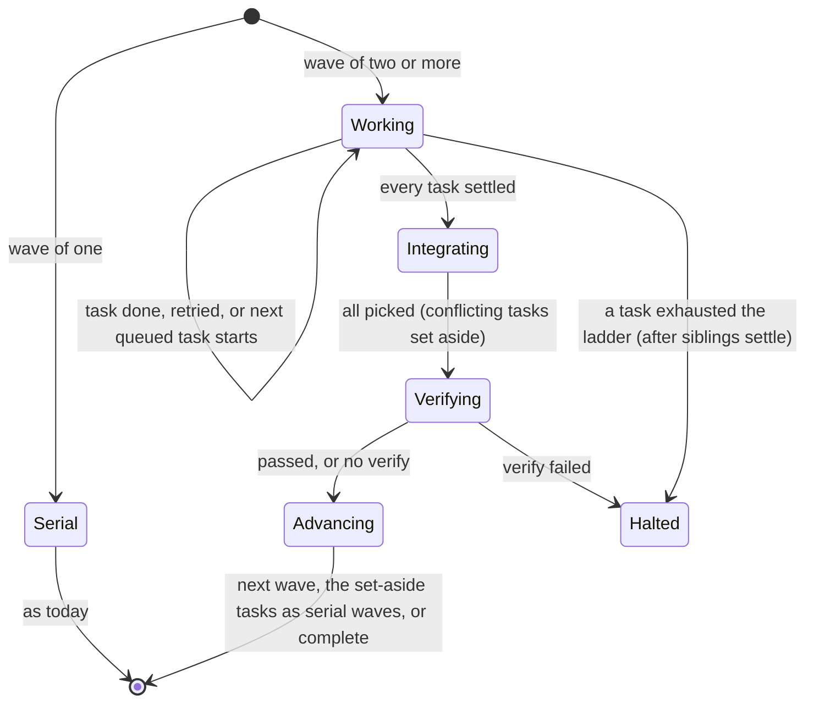

# Parallel Task Execution — Specification

Oct 19, 2026 · revised Oct 20, 2026 · @Tim · Branch `parallelism` · Status: design settled after the probes, nothing built

Today a tierminator run is serial: one worker at a time, in one working tree, with a failed attempt undone
by `git reset --hard`. This spec adds parallel execution of independent tasks. The planner declares which
tasks depend on which; tierminator groups them into waves; the tasks of a wave run at the same time, each in
its own Git worktree that tierminator makes; and their commits are cherry-picked onto the run branch in plan
order. A task whose pick conflicts is simply run again, serially, on the integrated result.

Decisions were made with the user on 2026-10-19 and 2026-10-20 and are in
[Decisions already made](#decisions-already-made). Claims about how Claude Code behaves are measured in
[`tierminator-parallel-findings.md`](tierminator-parallel-findings.md) (evidence under `probes/evidence/`); where
the design depends on a measurement, it says which. The spec was revised on 2026-10-20 after the probes and a
design review: tierminator makes the worktrees (option C), conflicts re-run serially, integration happens in the
main tree, and the resolver, the overlap flag and parts of resume, limit handling and display are deferred.

## Goals and non-goals

**Goals**

- **Wall-clock time and use of the usage limit.** Independent tasks finish in roughly the time of the slowest,
  and a run draws on the usage limit while the user waits.
- **Serial plans do not change.** A plan with no `after` field runs exactly as it does today, on the same
  code path, with the same tests passing unmodified.
- **Deterministic.** Waves, dispatch, integration order and halting come from hook code, never from a model
  recalling them.
- **Same safety rules.** One commit per task, no pushing, no pause between tasks, a failed attempt is rolled
  back, and a halt leaves the evidence in place.

**Non-goals**

- Starting a task as soon as its own dependencies finish. Tasks start by wave: a task waits for the whole
  previous wave. Waves give a deterministic history in plan order and one base for every slot of a wave, which
  is what makes "the main tree was not touched" checkable. (A ready-set scheduler would be faster and is a
  possible later optimization.)
- Enforcing independence. There is no `files` field and H2 does not reject overlapping tasks; the planner's
  judgment and the serial re-run of a conflicting task cover it. A review flag that asks the planner to confirm
  two parallel tasks naming the same file (O6) is deferred.
- A model that resolves merge conflicts (deferred; see [Conflicts](#conflicts)).
- Unattended parallel runs in the default permission modes (see [Permissions](#permissions)).
- Nested subagents, per-task approval gates and pushing, as before.
- Grindinator changes. It drives tierminator headless and gets parallelism if it runs in auto or
  `bypassPermissions` mode.

## Decisions already made

| # | Decision |
|---|---|
| D1 | The plan declares dependencies with `after`. Waves are derived from the graph. |
| D2 | A task with no `after` depends on the task before it (today's behavior). Parallelism needs `after: []` or an explicit list. |
| D3 | A failed task retries up the tier ladder in place, in a fresh worktree, while its siblings keep running. The wave closes when every task has settled. If a task exhausts the ladder, its siblings finish, the tasks that passed are integrated, and the run halts. |
| D4 | Each task runs in its own Git worktree. Finished tasks are brought back by cherry-pick, in plan order, one commit per task. **Revised 2026-10-20:** the picks are made in the main tree, on the run branch (no integration worktree). |
| D5 | **Revised 2026-10-20:** there is no conflict-resolver agent in the first release. A pick that conflicts is aborted, the wave's other tasks are integrated, and the conflicting task is run again, serially, on the new HEAD. |
| D6 | The cap on tasks running at once is `TIERMINATOR_MAX_PARALLEL`, default 5. |
| D7 | The plan has an optional plan-level `setup` (run in each new worktree) and `verify` (run after a parallel wave is integrated). **Revised 2026-10-20:** a failed `verify` halts the run; nothing repairs it. |
| D8 | `/tierminator:execute --from` is refused for graph plans; they resume from what is committed. Plans without `after` keep `--from`. |
| D9 | Plans show waves. The run summary's speed-up and wave lines are deferred. |
| D10 | Headless runs (`claude -p`) run waves in parallel too, in auto or `bypassPermissions` mode. |
| D11 | There is no `files` field (the user chose to skip it). |
| D12 | **2026-10-20, option C:** tierminator makes each task's worktree itself (H4 `pre`, at the wave base), and the worker is not isolated: it works there under rules in its prompt, and a guard hook denies calls that would reach the main tree. No `isolation`, no `worktree.baseRef`. |
| D13 | **2026-10-20:** in the default and `acceptEdits` permission modes every worker command asks for approval and a `cd ... && git ...` command offers no permanent rule; unattended and headless parallel runs use `auto` or `bypassPermissions`. It is documented as a restriction of unattended mode. |
| D14 | **2026-10-20:** the first release is the packages listed in [Rollout](#rollout); the resolver, the overlap flag, the usage-limit rule, the result-file fields and the display and summary changes are deferred. |

## Concepts

- **Graph plan.** A plan in which at least one task has an explicit `after`. Any other plan is a *serial
  plan*, and runs the serial way.
- **Wave.** `wave(T) = 1` when `T` has no dependencies, else `1 + max(wave(d))` over its dependencies `d`.
  All tasks in a wave are independent of each other, since a dependency always lands in an earlier wave.
- **Serial wave.** A wave of one task. It runs in the main working tree through today's code, unchanged:
  `current`, the clean-tree check, `reset --hard` on failure. A serial plan is nothing but serial waves.
- **Parallel wave.** A wave of two or more tasks. It runs through the wave machinery below.
- **Run branch.** The branch the run started on (`state.branch`). The main working tree stays on it and stays
  untouched by the workers for the whole wave.
- **Wave base.** The run branch's HEAD when a wave starts.
- **Slot.** The state of one task in a parallel wave (its attempt, tier, worktree, branch and so on). It is
  what `current` is for a serial wave.
- **Slot worktree and branch.** Made by tierminator at the wave base: the worktree at
  `<repo>/.claude/worktrees/tierminator-<run>-<task>` (in drive-letter, forward-slash form, never a name starting
  with `agent-`, which Claude Code uses for its own), the branch `tierminator/<runId>/<task>`.

## The plan

### Task block

```json
{
  "setup": ["npm ci"],
  "verify": "npm test",
  "tasks": [
    { "id": "T01", "title": "…", "model": "sonnet", "effort": "medium", "prompt": "… Verify: …" },
    { "id": "T02", "title": "…", "model": "sonnet", "effort": "medium", "after": [],            "prompt": "…" },
    { "id": "T03", "title": "…", "model": "haiku",  "effort": "high",   "after": [],            "prompt": "…" },
    { "id": "T04", "title": "…", "model": "opus",   "effort": "medium", "after": ["T02","T03"], "prompt": "…" }
  ]
}
```

| Field | Rule |
|---|---|
| `tasks[].after` | Optional array of task ids. Absent: `[previous task's id]`, or `[]` for `T01`. Each id must name an earlier task (so a cycle cannot be written). No duplicates, no self reference. Redundant edges (a dependency already implied by another) are allowed. |
| `setup` | Optional array of command strings, run in order in each new worktree. See [Setup](#setup). |
| `verify` | Optional string, one command, run after a parallel wave is integrated. See [Plan-level verify](#plan-level-verify). |

The top-level object may hold only `tasks`, `setup` and `verify`. Ids still run `T01`, `T02`, … in order with
no gaps, which is now a topological order; execution order within a wave, and integration order, is id order.

`parseBlock` normalizes every task to carry an explicit `after`, and records `graph: true` when the planner
wrote any `after`. Everything downstream reads the normalized array.

### Validation (H2)

Adds to today's checks: `after` is an array of strings naming earlier tasks; no duplicates; `setup` is an
array of non-empty single-line strings (at most 10); `verify` is a non-empty single-line string; no unknown
top-level keys. Errors are collected, as now.

### The approval table

The generated section gains a `Wave` and an `After` column, and lists `setup` and `verify` verbatim, because
the approved plan makes tierminator run those commands:

```
| ID  | Wave | After    | Title … | Model | Effort | Prompt |
Setup: npm ci
Verify (after each parallel wave): npm test
Waves: 1: T01, T02, T03 · 2: T04
```

The tasks file and its hash cover the whole block, so `setup` and `verify` cannot change after approval. For a
graph plan only; a serial plan's table is byte for byte as it is.

### Planner rules (`rules/tiering.md`)

New section "Dependencies and parallel tasks". The rules tell the planner to:

- leave `after` off when each task needs the one before it (the common case);
- write `after: []` or a list only when tasks truly can run at once: they read and change different files,
  need none of each other's output and share no build output;
- give each parallel task its own `Files to change:` line and keep those lines disjoint (guidance only);
- remember that a task also waits for every other task in its dependencies' wave, so splitting a chain into
  a wide graph helps only if the waves are wide;
- put work every task needs (a shared interface, a rename) in an earlier wave.

The existing line "A task can depend only on earlier tasks" is replaced.

## Execution

### Lifecycle



### Starting a wave

1. The hook that settles the previous wave (or approval, for wave 1) computes the next wave from the tasks
   not yet done, treating done tasks as satisfied.
2. A wave of one is a serial wave. Otherwise the wave base is recorded, the slots are created, and the first
   `min(size, cap)` tasks are marked startable. The cap is `TIERMINATOR_MAX_PARALLEL` (a positive integer; an
   unset or invalid value means 5). Tasks beyond the cap are queued and start, in id order, as slots free.
3. Before the first parallel wave of a run, `.claude/worktrees/` is added to the repository's `info/exclude`
   (otherwise the main tree shows `?? .claude/` and fails the clean-tree check).
4. Claude is told to make all the startable Agent calls **in one message**, each with its exact dispatch
   text. Each call is checked by H4 (`pre`) against the slot it names.

### The dispatch of one task

The prompt is today's (`Tasks file:`, `Plan:`, `Task:`, and for a retry `Retry:` and `Reason:`) plus, in a
parallel wave, a `Parallel: yes` line and a `Worktree: <path>` line. Tierminator makes the worktree; the worker
is not isolated (D12, measured in the findings, "Option C"):

- **H4 `pre`** finds the slot from the `Task:` line, checks the call, and runs
  `git worktree add -b tierminator/<runId>/<task> <path> <waveBase>`, serialized through the state lock below.
  The Agent call is not changed: no `isolation`, no `updatedInput`, no `permissionDecision`. A call that carries an
  `isolation` is denied. A failed `git worktree add` denies the call with Git's message and is fatal for the wave.
- **The worker's rules**, a Parallel section in the shared body of the tier agents: `WT` is the `Worktree:` path;
  run the tasks file's `setup` first, in `WT`; a `cd "<WT>" && ` prefix on every Bash command (its shell forgets
  any `cd` as soon as a command ends); never PowerShell; absolute paths starting with `WT` for Write, Edit and
  Read (the tasks file is the one exception); Glob and Grep with `path` set to `WT`; never build a path from
  `pwd` output (Git Bash prints `/tmp/...`, which file tools resolve to the wrong place); commit on the branch
  already checked out and never leave `WT`.
- **A guard hook** (`h8-worktree-guard.js`, `PreToolUse` on Bash, PowerShell, Write, Edit, Glob and Grep) that,
  for tierminator's workers while a wave is active, denies a Bash command without a `cd` into the worktrees
  directory, any PowerShell call, a Write or Edit outside it, and a Glob or Grep without a `path` inside it. It
  judges by a path prefix, so it cannot tell one slot's worktree from another's. It only denies, never grants a
  permission, and never rewrites a tool input.
- **Which slot a worker is.** The `Task:` line in the first message of the worker's transcript
  (`agent_transcript_path` on `SubagentStop`), or `PostToolUse` on the Agent call, joined to the slot by agent id.

### Judging a task

As today, at the slot's worktree path: a readable report (or the Git evidence that stands in for it), exactly one
commit since the slot's recorded head carrying `Tierminator-Task: <id>` and `Tierminator-Plan: <planId>`, a
clean tree, and the worker still on its own branch. Also checked: **the main tree is still on the wave base and
its status is empty.** If not, some worker left its worktree; the leaking slot cannot be told, so the wave halts
(the fatal "MAIN TREE:"). Other fatals: a failed setup ("SETUP FAILED:") and a worktree that could not be made
("WORKTREE CREATE:"). The report block, the turn-limit resume (at most twice) and the single request for a
missing report are unchanged and work per slot; when `SubagentStop` carries no `last_assistant_message` (as in
auto mode) the report is read from the transcript.

A failed attempt is rolled back by **discarding the worktree and its branch** and creating a fresh one from
the same wave base, at the next tier up (at most two retries, as now). No `reset --hard` is run in a parallel
wave. The other slots are not touched.

### Closing a wave

A wave closes when no slot is in flight and none is queued to start.

- **All tasks done.** Integrate.
- **A task exhausted the ladder or hit a fatal.** Nothing queued starts. In-flight siblings finish, and are
  judged, retried or not as usual. When the last settles, the tasks that passed are integrated (so their work
  is kept and `/tierminator:execute` later skips them), and the run halts. The halt names the failed task.

### Integration

Run by hook code (no model), in the main tree, on the run branch:

1. Check the main tree is on the wave base with an empty status. If the user committed during the run, or a
   worker leaked, the run halts with that reason ("MAIN TREE:").
2. For each done task of the wave in id order, `git cherry-pick <slot branch tip>` (no `-x`, so the message and
   its `Tierminator-` trailers are kept as they are, which `committedTasks` reads for resuming).
3. A clean pick continues to the next. A conflicting pick is aborted (`git cherry-pick --abort`, leaving the tree
   as it was), the task is set aside, and the rest of the wave is picked. See [Conflicts](#conflicts).
4. When every pick is in, the plan's `verify` runs in the main tree ([Plan-level verify](#plan-level-verify)).
5. The slot worktrees and branches of the integrated tasks are removed (`worktreeRemove`, `branchDelete`). A set
   aside task's branch is kept until its serial re-run finishes.

Integration happens once per wave, so history on the run branch is linear: the commits of the wave in id order,
then the re-run of any conflicting task, one commit per task. If a run halts in the middle of a wave, the picks
already made stay on the branch, and resume skips them by their trailers.

### Conflicts

There is no resolver agent in the first release. When a pick conflicts:

- the pick is aborted and the task set aside; the other tasks of the wave are integrated as usual;
- after the wave (and its `verify`), the set-aside tasks run as **serial waves**, in id order, on the new HEAD,
  at the tier they last ran, in a fresh attempt with no ladder step charged. A serial task runs alone, so it cannot
  conflict again; its own `Verify:` runs as always;
- the final summary counts the conflicts, which also tells whether a resolver would ever pay off.

The cost is one task's work done twice. A merge-conflict resolver (an `opus`/`high` agent working in an
integration worktree with the pick in progress, with the `Worktree:` rules above) is deferred and described in
`parallel/WP-12`; it can be added if conflicts turn out to be common.

### Setup

`setup` commands run in each new worktree before the worker starts the task. The worker runs them (the prompt
says `Parallel: yes`; the worker's rules say to run the tasks file's `setup` list first, in order, in its
worktree, and to stop at the first failure). A failed setup is not the worker's fault: it reports `FAILED` with a
`NOTE:` starting `SETUP FAILED:`, and the judge treats that as **fatal** (the run halts, no retry up the
ladder, since a bigger model cannot fix a missing tool). A list of strings, not one string, so no `&&`
chaining is needed and each command is the platform shell's own.

Setup is for what a fresh worktree lacks because Git does not track it: restores, `node_modules`, a copied
`.env`. It does not run in serial waves, whose tree is already set up.

### Plan-level verify

`verify` is one command, run by hook code in the main tree after all picks of a **parallel wave** (never for a
serial wave, which its task's own `Verify:` already covers). It guards against picks that apply cleanly and still
break together.

- Exit 0 passes. Anything else fails, with its output (tail, bounded) kept.
- A failure **halts the run**, naming the command and the output. Nothing repairs it, and the picks stay on the
  run branch (each is a commit that passed its own `Verify:`); the slot branches are kept until cleanup. The
  user fixes the break and `/tierminator:execute` resumes with the remaining tasks. Verify runs again after the
  next parallel wave, not on resume.
- It runs under the hook's timeout in `hooks.json`, whose value comes from probe P5.

### State

A parallel wave replaces `current` with `wave`; a serial wave keeps `current`, so serial plans are untouched.

```
wave: {
  n, size, base,                       // wave number, task ids, wave base sha
  slots: { T02: {attempt, tier, tried[], head, worktree, branch, inFlight, report,
                  lastFailure, agentId, resumes, resumePending, turnLimited, asked, resumeFor,
                  startedAt}, … },
  queue: ['T05'],                      // not started yet
  phase: 'working' | 'integrating' | 'verifying',
  halting: null | {task, reason},      // set when a task exhausted the ladder
  setAside: ['T03']                    // conflicting tasks to re-run serially after the wave
}
```

`done` is unchanged, and gains `wave`. `runId`, `planId`, `branch`, `spend` and the rest of the run state are
unchanged.

**Readers of `state.current`.** Several hooks assume a serial run and read `current` directly: `h1-plan-rules.js`
(hand-back and turn-limit notes), `h4-dispatch.js`, `h5-guard.js` (the stop and edit guards), `h7-limit.js` (through
`lib/result.js`'s `currentId`), `lib/result.js` (`run = ... && !!s.current`) and `lib/spend.js` (`recordAttempt`
and `outcomeOf` read `prev.current`, and a wrapper swallows the error, so a wave state would silently lose its
attempts). Each must handle a wave state, and the work package that introduces the wave state audits them all.

**The state lock.** Several workers can stop within milliseconds, in separate hook processes, and today's
read, change, `write` is not atomic as a whole (only the write is; `claimAttempt` guards single attempts).
Parallel waves need a transaction: `state.update(sessionId, fn)` takes an exclusive lock file beside the state
(`wx` create, short retries, and a stale-lock timeout that removes a lock whose owner died), reads, applies
`fn`, writes, and releases. Every parallel-wave mutation goes through it. Attempt keys gain the task id so
claims are per slot. The Windows rename retries in `write` stay.

### Notices

Every hand-back or finish of a task yields a notice for that task, as now. Since several can arrive
back-to-back, the notice says only what is true at that moment:

- queued tasks and free slots: dispatch the next startable one(s);
- others still running: end your turn (the next hand-back will say more);
- the last task settled: integration ran in the hook, so the notice gives the next wave's dispatch text, the
  completion text or the halt text.

H5 keeps blocking main-thread edits and early stops; its wait-states understand that several workers are in
flight.

### Permissions

Measured in the findings ("Option C"). `bypassPermissions` and `auto` ask nothing. In the default and
`acceptEdits` modes every worker Bash command asks for approval, and the compound `cd "<dir>" && git ...` form
offers no permanent "allow" rule, so a person must answer one request per commit for the life of the run. A run
with nobody to answer (headless `claude -p`, Grindinator, an overnight run) must use `--permission-mode auto` or
`bypassPermissions`; in the default mode its workers finish the work and cannot commit. The start notice of a
graph plan says so when the permission mode is `default` or `acceptEdits`. The guard hook only denies and the
rest of tierminator still grants no permission.

## Usage limit and resuming

**Usage limit (deferred).** Today's rule stands: a limit ends the run once (H7 records outcome `limit`). What
happens to the other slots that end because of the same limit, and the worktrees they leave behind, is deferred to
`parallel/WP-15`; until then the leftovers are removed by name at the next start.

**Resuming.** `/tierminator:execute` already skips tasks whose commits are on the branch. For a graph plan:

- done tasks are those whose `Tierminator-Task:` commits are on the branch; waves are recomputed over the rest,
  with a done dependency counting as satisfied;
- `--from Txx` is refused with a message saying graph plans resume from what is committed (D8);
- before starting, it removes what an earlier halted or ended run left, by name: `tierminator/<oldRunId>/*`
  branches and the worktrees `.claude/worktrees/tierminator-*`, after telling the user what it found. Anything
  that does not match is the user's and is never touched.

## Headless

`claude -p` runs waves the same way, with no approval, in `auto` or `bypassPermissions` mode (see
[Permissions](#permissions)). The result file's new optional fields (`waves`, `parallelPeak`,
`wallClockSeconds`) are deferred with WP-15; the result file otherwise works as today, once the readers of
`state.current` handle a wave.

## Telemetry and display

- **Attribution** already reads each worker's own transcript by agent id (`lib/spend.js`), not by time window,
  so overlapping workers are counted correctly; the one fix needed is that `recordAttempt` and `outcomeOf` read
  the slot and not `prev.current` (see Readers of `state.current`).
- **Run lines, the end summary's wall-clock and speed-up, and the wave field on spend records** are deferred to
  `parallel/WP-16`. A parallel run's summary otherwise shows what a serial run's does.
- **Plan table** shows waves, as above.

## Changes by file

| Area | Change |
|---|---|
| `lib/tasks.js` | `after`, `setup`, `verify`; validation; normalized output; `graph` flag. |
| `lib/waves.js` (new) | Pure: waves from the graph, recomputed over remaining tasks, startable set under the cap. |
| `lib/run.js` | Unchanged for serial waves. |
| `lib/wave-run.js` (new) | Slot analogues of `expectedCall`, `checkDispatch`, `judge`, `advance`, `noticeText`; slot placement. |
| `lib/state.js` | `update` with the lock; claims keyed by task. |
| `lib/git.js` | Worktree add/remove/prune, branch delete, cherry-pick (with conflict reporting and abort), exclude entry, drive-letter paths, leftover detection by name. All swallow errors as the rest do. |
| `lib/integrate.js` (new) | Integration in the main tree, the set-aside tasks, and `verify`. |
| `h2-gate-exit-plan.js` | Validation; table with waves. |
| `h3-post-approval.js`, `lib/execute.js` | Start the first wave; graph-plan resume; `--from` refusal; leftover cleanup; the permission line. |
| `h4-dispatch.js`, `lib/h4-wave.js` (new) | Per-slot `pre` (makes the worktree), `stop`, `post`, `failure` and resume hooks for parallel waves; serial paths untouched. |
| `h8-worktree-guard.js` (new) | The guard hook. |
| `h1-plan-rules.js`, `h5-guard.js`, `h7-limit.js`, `lib/result.js`, `lib/spend.js` | Handle a wave state (see Readers of `state.current`); hand-back and wait-states per slot. |
| all tier agents | A "Parallel" section in the shared worker body. |
| `hooks/hooks.json` | The guard hook; longer timeouts for the hooks that make worktrees, integrate and verify (P5). |
| `rules/tiering.md` | The dependency section. |
| Docs | `tierminator-reference.md` (replace the "Serial only" non-goal), `README.md`, `CLAUDE.md`, `docs/README.md`, the spike spec's non-goal note. |

Deferred, with their packages: `lib/sizing.js` (the overlap flag, WP-05), `agents/resolver.md` and `lib/resolver.js`
(WP-12), the repair half of verify (WP-13), the limit rule and result fields (WP-15), run lines and summary (WP-16).

## Probes

Each probe lives under `probes/`, writes `probes/evidence/tierminator-parallel-*`, and gets a findings
section before the code that depends on it. They run on the Claude Code version in use.

| # | Question | Status |
|---|---|---|
| P1, P2 | Worktree placement (Agent `isolation`, hook-made worktrees). | **Done**, with re-runs, a base-mechanism round and an option C round (38 runs); option C chosen (D12). |
| P3 | Do several Agent calls in one message run concurrently? Do their `pre` hooks overlap? | **Mostly answered** by the option C round (foreground workers overlap; the hooks ran one after another). Remaining, in WP-02: background (interactive) dispatch. |
| P4 | When three background workers finish close together, how many prompts reach Claude, in what order? | Open (WP-02). |
| P5 | Can a hook run for minutes with a raised `timeout`? Is there a maximum? | Open (WP-02); decides the hook timeouts. |
| P6 | Git on Windows: concurrent `git worktree add`, path length, conflict reporting, trailers surviving a pick, removal of a locked worktree. | **Dropped as a probe**; the real-repo tests in WP-06 cover it (hooks do not run concurrently in the probes). |
| P7 | A seeded conflict resolved by `opus`. | **Dropped** with the resolver (WP-12). |
| P8 | A usage limit with several workers in flight. | **Deferred** with WP-15. |
| P3b | The lost-update count of the state file. | **Dropped**; WP-07's concurrent test proves it. |

## Rollout

Phases, each ending with its tests passing and its acceptance criteria met. The phases are split into paste-ready
work packages in [`parallel/`](parallel/README.md), which map to the phases below.

**First release**

1. **Probes** (done for placement; WP-02 for P3 background, P4 and P5).
2. **Plan format**: `tasks.js`, `waves.js`, H2 table, rules, tests (WP-03, WP-04). A graph plan is accepted and
   shown, and still runs serially (every wave treated as serial) until phase 4.
3. **Git and state**: worktree/pick/abort/exclude helpers, `state.update` with real concurrent writers (WP-06, WP-07).
4. **Parallel waves**: slots, dispatch, the guard, judging, retries, closing, integration in the main tree, the
   serial re-run of a conflicting task, halt-only verify, the audit of readers of `state.current` (WP-08 to WP-11).
5. **Resume and cleanup by name** (WP-14).
6. **Documentation and the end-to-end run** (WP-17, eight scenarios).

**Deferred** (written, not scheduled): the overlap flag (WP-05), the conflict resolver (WP-12), verify repair
(WP-13), the usage-limit rule, result fields and headless extras (WP-15), the display and summary (WP-16).

**Done means**

- Three independent tasks finish in about the time of the slowest, plus integration.
- A serial plan's behavior, state and tests are unchanged.
- A forced conflict is integrated by re-running the conflicting task serially, and the history is linear with one
  commit per task.
- A failed task retries in place while siblings run; an exhausted one halts after the siblings settle with the
  passers integrated, and `/tierminator:execute` resumes the rest.
- A failed plan-level `verify` halts the run with the output named.
- The same holds headless in auto or `bypassPermissions` mode, and the permission restriction is documented.

## Risks

- **The state race** is the main correctness risk; it is why the lock is a phase of its own with real
  concurrent tests.
- **Workers reaching the main tree.** Mitigated by the worker rules, the guard hook, and the main-tree check at
  judging and at integration; measured with 38 small runs, not with long tasks.
- **Permissions in the default modes** (see [Permissions](#permissions)).
- **Readers of `state.current`** that break silently on a wave state; one package audits them.
- **Independent tasks that were not.** A conflicting task costs a serial re-run; picks that apply cleanly and
  break together cost a halt at `verify`. Planner guidance is the only prevention until the overlap flag exists.
- **Machine load.** Several builds at once slow each other and can lose to a single serial build. The cap is
  the control.
- **Rate limits** are drawn down faster by design; handling of a limit mid-wave is deferred.
- **Complexity of H4.** The serial paths stay as they are; wave logic lives beside them, not inside them.

## Open decisions

| # | Question | Status |
|---|---|---|
| O1 | Keep serial waves on today's code, with `wave` state only for parallel waves, or unify on slots? | **Decided 2026-10-19:** keep both; revisit unifying once parallel runs have evidence. |
| O2 | On a failed plan-level `verify`, what happens? | **Revised 2026-10-20:** halt, with no repair (it was: send the resolver in once, then halt). |
| O3 | Is `setup` run by the worker or by hook code at worktree creation? | **Decided 2026-10-19:** the worker. |
| O4 | `setup` shape. | **Decided 2026-10-19:** a list of command strings. |
| O5 | Add the result file's fields without bumping its version? | **Deferred** with WP-15. |
| O6 | A review flag in the sizing check for two independent tasks that name the same file. | **Deferred 2026-10-20** (WP-05). |
| O7 | Names: `TIERMINATOR_MAX_PARALLEL`, branches `tierminator/<runId>/<task>`, worktrees `tierminator-<run>-<task>`. | As written. `TIERMINATOR_VERIFY_TIMEOUT` and the agent `tierminator:resolver` are dropped. |
| O8 | A failed `verify` leaves the picks on the run branch (no reset to the wave base). | **Proposed 2026-10-20, to confirm:** simpler, and each pick passed its own `Verify:`; the alternative is a `reset --hard` that unwinds the whole wave and needs the slot branches re-picked on resume. |
